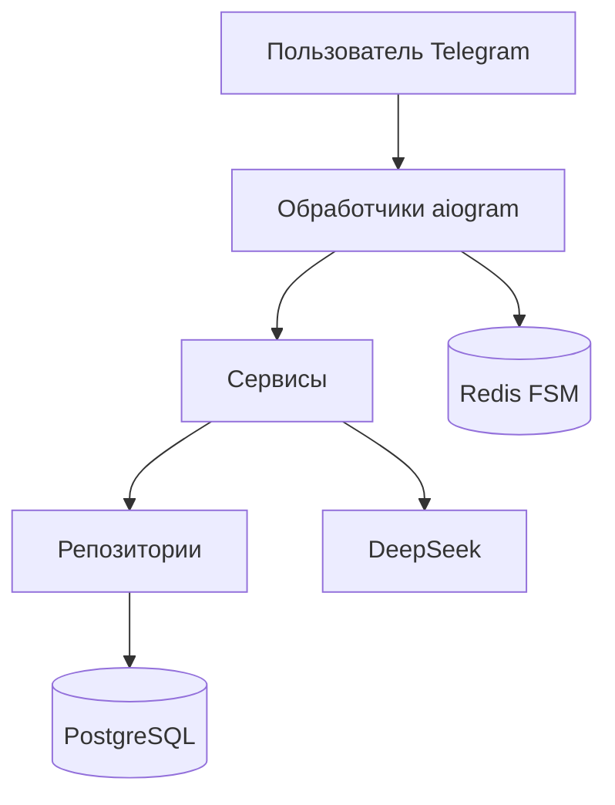

# AI Interview Bot

Telegram-бот для тренировочного технического собеседования на позицию Backend / Python.

Пользователь указывает вакансию и уровень, отвечает на вопросы текстом и получает оценку каждого ответа, сильные и слабые стороны и итоговый разбор. Два собеседования в календарный месяц бесплатно. Premium снимает лимит на 30 дней и оплачивается через Telegram Stars.

## Возможности

- Вопросы под должность, требования вакансии и уровень Junior, Middle или Senior
- Оценка каждого ответа и итоговый отчёт
- История собеседований и профиль со статистикой
- Premium-подписка с оплатой в Telegram Stars
- Админка на локальном компьютере: пользователи, блокировка, промпты

## Стек

Python, aiogram, FastAPI, PostgreSQL, SQLAlchemy, Alembic, Redis, DeepSeek.

## Как устроено



Обработчики принимают сообщения. Сервисы ведут собеседование и ходят в модель. Репозитории читают и пишут PostgreSQL. Состояние диалога хранится в Redis.

## Запуск

Нужны Python 3.13, Docker и токен бота из BotFather.

```bash
***AI Interview Bot***
Telegram-бот для подготовки к техническим собеседованиям на Backend/Python-позиции с использованием Large Language Models (LLM).
Бот проводит пользователя через полноценное техническое собеседование: формирует вопросы с учётом позиции, требований вакансии и уровня сложности, оценивает ответы и предоставляет итоговую обратную связь.
Возможности
Настройка собеседования — выбор позиции, требований вакансии и уровня сложности.
Генерация технических вопросов — создание набора вопросов с помощью LLM.
Автоматическая оценка ответов — анализ ответов по заданным критериям.
Итоговый отчёт — оценка результатов, сильные и слабые стороны, рекомендации по дальнейшей подготовке.
История собеседований — сохранение результатов и возможность просматривать предыдущие собеседования.
Профиль пользователя — просмотр информации и статистики.
Premium-подписка — доступ к расширенным возможностям по платной подписке.
Оплата через Telegram Stars — встроенная система оплаты подписки.
Технологический стек

**Архитектура**
Приложение организовано с разделением ответственности между обработчиками Telegram-событий, бизнес-логикой и слоем доступа к данным.
Telegram User
|
v
Telegram Bot API
|
v
aiogram Handlers
|
v
Services
|
+------------------+
| |
v v
Repositories LLM API
|
v
SQLAlchemy
|
v
PostgreSQL
**Основные компоненты**
Handlers — обработка команд, сообщений и нажатий на кнопки.
Services — бизнес-логика проведения собеседований, обработки ответов и формирования результатов.
Repositories — операции чтения и записи данных.
Database models — модели пользователей, собеседований и ответов.
FSM — управление состояниями многоэтапного пользовательского сценария.
Сценарий работы
Пользователь запускает бота.
Выбирает позицию и указывает требования вакансии.
Выбирает уровень сложности.
Бот формирует вопросы для собеседования.
Пользователь последовательно отвечает на вопросы.
LLM анализирует ответы и формирует обратную связь.
Бот сохраняет результаты и показывает итоговый отчёт.
Пользователь может просмотреть историю собеседований или воспользоваться Premium-подпиской.
Работа с данными
PostgreSQL используется для хранения данных пользователей и истории собеседований. SQLAlchemy обеспечивает взаимодействие с базой данных, а Alembic — версионирование и применение изменений схемы.
Подписка и платежи
В проекте реализована Premium-подписка с оплатой через Telegram Stars.
Платёжный сценарий интегрирован с Telegram Bot API и позволяет пользователю оформить платный доступ непосредственно в боте.
Запуск проекта
Требования
Python — версия согласно настройкам проекта.
PostgreSQL.
Telegram Bot Token.
API-ключ используемого LLM-провайдера.
Установка
>>>>>>> 7f18ea238884c4ccf5f81f25f28c2e6ede911788
git clone <repository-url>
cd AI-interviewer

python -m venv .venv
```

Windows:

```powershell
.venv\Scripts\Activate.ps1
```

Linux и macOS:

```bash
source .venv/bin/activate
```

```bash
pip install -r requirements.txt
copy .env.example .env
```

На Linux и macOS вместо `copy` используйте `cp .env.example .env`.

Заполните `.env` своими значениями. Образец и комментарии лежат в `.env.example`. Файл `.env` в git не попадает.

Поднимите базу и Redis, примените миграции и запустите бота:

```bash
docker compose up -d
alembic upgrade head
python main.py
```

`python main.py` поднимает бота, админку на `http://127.0.0.1:8000` и раз в сутки сохраняет копию базы в `backups`. Окно должно оставаться открытым. Повторный запуск в другом окне не стартует, пока работает первый.

Админка слушает только этот компьютер. Пароли админки и Redis в `.env` нужно задать свои: значения по умолчанию из примера для запуска не подходят.

## Проверка

```bash
pytest
```

## Сценарий в боте

1. Пользователь нажимает «Начать собеседование».
2. Вводит должность, требования вакансии и уровень.
3. Отвечает на вопросы текстом.
4. Получает оценку ответа и следующий вопрос.
5. В конце видит итоговый балл и разбор.
6. Историю и статус подписки смотрит в меню. Premium оформляется кнопкой в боте.
=======
Запустите приложение командой, соответствующей точке входа проекта.
Безопасность
Секреты и API-ключи должны храниться в переменных окружения.
Файл .env не должен попадать в Git.
Перед публикацией репозитория необходимо удалить реальные токены, пароли и персональные данные из конфигурации и примеров.
Статус проекта
Проект запущен и доступен для использования в Telegram.
Автор
Разработано в рамках самостоятельного backend-проекта для практического применения Python, асинхронного программирования, работы с PostgreSQL, интеграции LLM и реализации платёжной логики.
