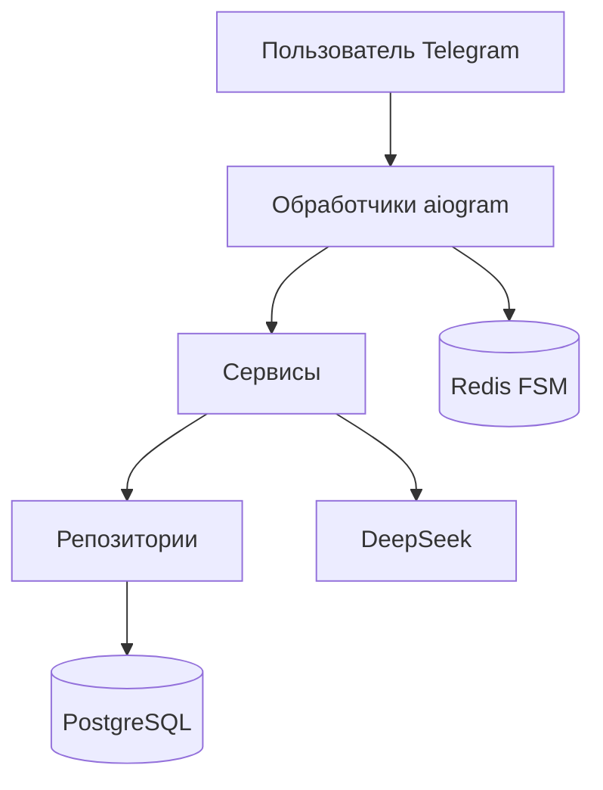

# AI Interview Bot

Telegram-бот для тренировочного технического собеседования на позицию Backend / Python.

Пользователь указывает вакансию и уровень, отвечает на вопросы текстом и получает оценку каждого ответа, сильные и слабые стороны и итоговый разбор. Два собеседования в календарный месяц бесплатно. Premium снимает лимит на 30 дней и оплачивается через Telegram Stars.

## Возможности

- Вопросы под должность, требования вакансии и уровень Junior, Middle или Senior
- Оценка каждого ответа и итоговый отчёт
- История собеседований и профиль со статистикой
- Premium-подписка с оплатой в Telegram Stars
- Админка на локальном компьютере: пользователи, блокировка, промпты

## Стек

Python, aiogram, FastAPI, PostgreSQL, SQLAlchemy, Alembic, Redis, DeepSeek.

## Как устроено



Обработчики принимают сообщения. Сервисы ведут собеседование и ходят в модель. Репозитории читают и пишут PostgreSQL. Состояние диалога хранится в Redis.

## Запуск

Нужны Python 3.13, Docker и токен бота из BotFather.

```bash
git clone <repository-url>
cd AI-interviewer

python -m venv .venv
```

Windows:

```powershell
.venv\Scripts\Activate.ps1
```

Linux и macOS:

```bash
source .venv/bin/activate
```

```bash
pip install -r requirements.txt
copy .env.example .env
```

На Linux и macOS вместо `copy` используйте `cp .env.example .env`.

Заполните `.env` своими значениями. Образец и комментарии лежат в `.env.example`. Файл `.env` в git не попадает.

Поднимите базу и Redis, примените миграции и запустите бота:

```bash
docker compose up -d
alembic upgrade head
python main.py
```

`python main.py` поднимает бота, админку на `http://127.0.0.1:8000` и раз в сутки сохраняет копию базы в `backups`. Окно должно оставаться открытым. Повторный запуск в другом окне не стартует, пока работает первый.

Админка слушает только этот компьютер. Пароли админки и Redis в `.env` нужно задать свои: значения по умолчанию из примера для запуска не подходят.

## Проверка

```bash
pytest
```

## Сценарий в боте

1. Пользователь нажимает «Начать собеседование».
2. Вводит должность, требования вакансии и уровень.
3. Отвечает на вопросы текстом.
4. Получает оценку ответа и следующий вопрос.
5. В конце видит итоговый балл и разбор.
6. Историю и статус подписки смотрит в меню. Premium оформляется кнопкой в боте.
